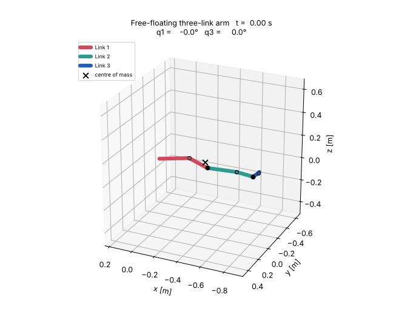
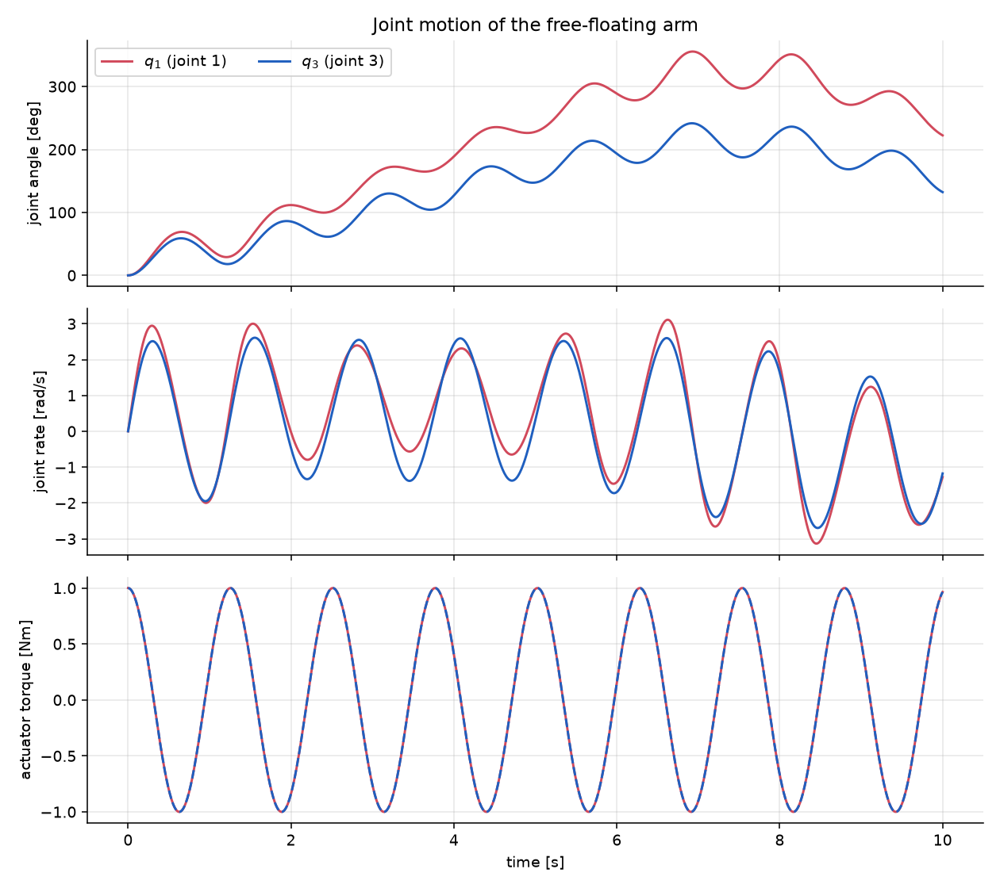
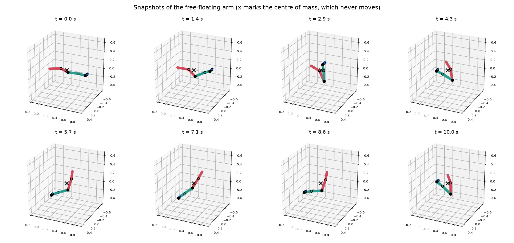
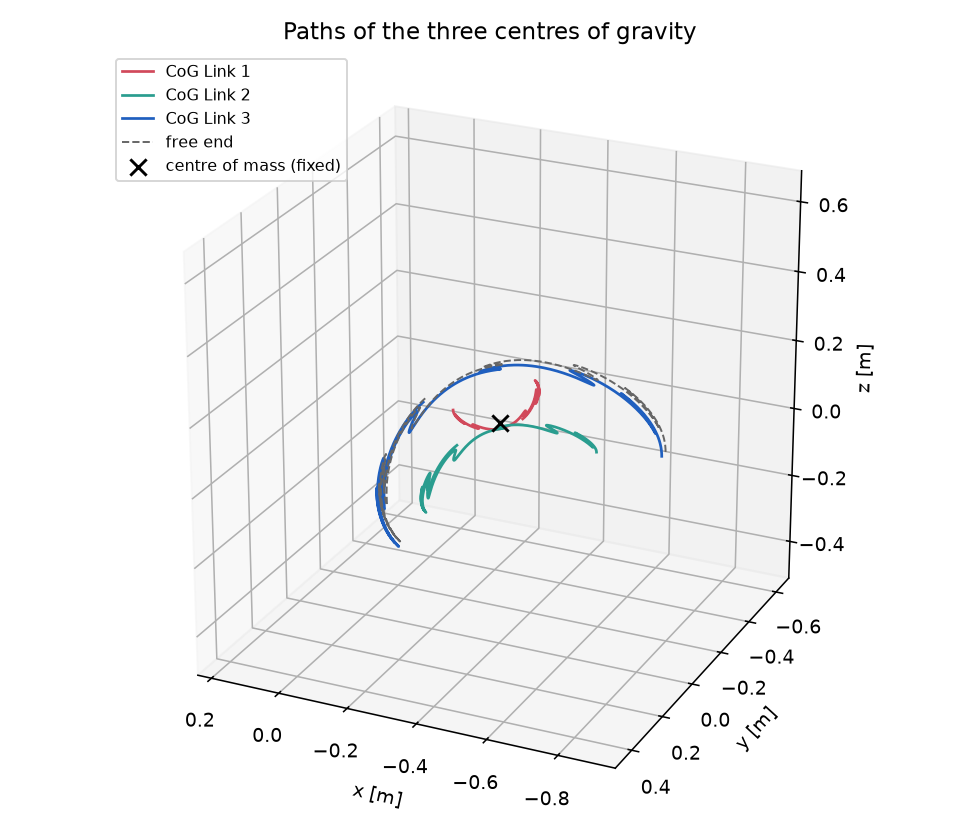
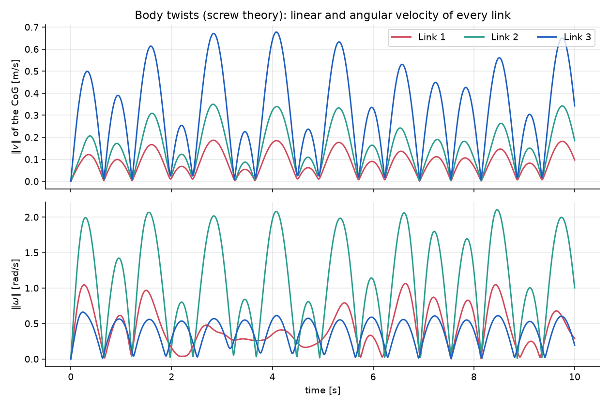
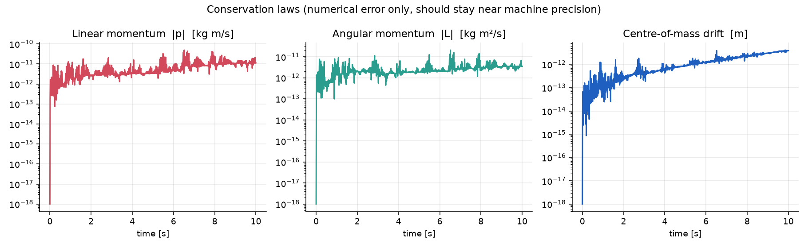
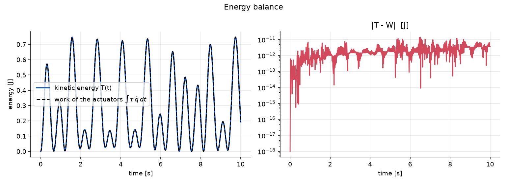

# Free-Floating Three-Link Arm — Screw Theory, Newton–Euler and Verification in Python

**A free-floating arm has no fixed base: when its two joints move, the whole chain moves.**
This project models such a three-link arm with screw theory (twists, wrenches, adjoint
transformations), simulates it in Python, and — more importantly — *verifies* the simulation
against conservation laws and an independent symbolic derivation.



> **Provenance.** The model, its parameters and the actuation come from a university
> assignment ("Topic Highlight", M.Sc. in Automation Engineering, University of Bologna,
> 2023/24) that I worked on together with a classmate. This repository is a later, clean
> **re-implementation in Python**, extended with an automated verification suite and this
> report, so that anyone can run and check it.

---

## 1. Summary

| | |
|---|---|
| System | 3 rigid links, 2 revolute joints, **no fixed base**, no gravity, no external forces |
| Input | joint torques  τ₁(t) = τ₃(t) = 1 Nm · cos(5 t)  (as in the assignment) |
| Method | Newton–Euler in body frames with screw-theory transformations; joint constraints solved as one 18×18 linear system per time step; DOP853 integration (rtol 1e-11) |
| Result (10 s) | joints reach q₁ ≤ 355.6°, q₃ ≤ 241.6°, peak joint rates 3.13 / 2.70 rad/s, peak kinetic energy 0.75 J |
| Verification | linear momentum ≤ 5·10⁻¹¹ kg m/s, angular momentum ≤ 2·10⁻¹¹ kg m²/s, centre-of-mass drift ≤ 4·10⁻¹² m, energy balance ≤ 1.4·10⁻¹¹ J |
| Independent check | planar version agrees with a symbolic Lagrangian derivation (sympy) to 10⁻⁹ |
| Tests | 11 automated tests (`pytest`) |

---

## 2. Background

### 2.1 Free-floating chains

A manipulator bolted to the ground can push against the ground. A free-floating one (a
satellite arm, an astronaut, a robot in zero gravity) cannot: with **no external forces**,

* the total linear momentum is constant (here: zero),
* the total angular momentum is constant (here: zero),
* therefore the **centre of mass of the whole chain stays where it is** and the links must
  rotate and translate *against* each other when a joint moves.

These three facts are exact consequences of the equations of motion. A simulation that
violates them has a bug, which makes them an excellent test (Section 6).

### 2.2 Screw theory in two lines

* A **twist** `V = [v; ω]` (linear velocity, angular velocity) describes the velocity of a
  rigid body; a **wrench** `W = [F; τ]` (force, torque) describes the load on it.
* Moving from frame *b* to frame *a* (pose `(R, p)` of *b* in *a*) uses the 6×6 adjoint

$$
\mathrm{Ad}_{(R,p)} = \begin{bmatrix} R & \hat p R \\ 0 & R \end{bmatrix},
\qquad V^a = \mathrm{Ad}\, V^b, \qquad W^b = \mathrm{Ad}^{\top} W^a ,
$$

where $\hat p$ is the skew-symmetric matrix of $p$. Wrenches use the transpose so that
power $W\!\cdot\!V$ is invariant. The twist ordering `[v; ω]` (linear part first) is used throughout.

---

## 3. The model

Three links of a UR5-type arm (link lengths 0.425 m and 0.39225 m and the offsets follow the
UR5 DH parameters) are connected in a chain **link 1 — joint 1 — link 2 — joint 3 — link 3**.
Both ends are free (zero wrench). All values below are those of the assignment; a test checks
that the link lengths and inertia tensors are physically sensible
(`test_parameters_are_physically_sensible`).

| | mass [kg] | inertia diag(J) about the CoG [kg m²] | input joint (from CoG) [m] | output joint (from CoG) [m] |
|---|---|---|---|---|
| Link 1 | 8.393 | 0.0149, 0.3564, 0.3553 | (0.2125, 0, −0.11336) | (−0.2125, 0, −0.11336) |
| Link 2 | 2.33 | 0.0025, 0.0551, 0.0546 (+ J₁₃ = 0.0034) | (0.24225, 0, −0.0265) | (−0.15, 0, −0.0265) |
| Link 3 | 1.1219 | 0.0149, 0.3564, 0.3553 | (0, −0.10735, −0.01634) | (0, 0.02561, −0.00193) |

* Link 3's input frame is rotated by 90° about x relative to its CoG frame.
* Link 3 uses the same inertia tensor as link 1 in the assignment data; it is kept as is.
* Joint *j* is a revolute joint about the common z-axis of the two joint frames; the other five
  relative degrees of freedom are constrained (3 translations + 2 rotations).
* Actuation: both joints receive $\tau(t) = 1\,\mathrm{Nm}\cdot\cos(5\,t)$, simulation time
  10 s.
* Initial pose: link 1 at the pose given in the assignment; links 2 and 3 follow from the chain
  geometry at $q = 0$. The initial poses given for links 2 and 3 agree with this
  chain to within 0.3 mm (rounding in the data); the test
  `test_initial_geometry_matches_the_stored_initial_poses` checks it.
* All velocities are zero at $t = 0$.

---

## 4. Method

**State.** The pose and body twist of link 1 (the "floating base") and the two joint angles:

$$
y = \big[\,P_1,\; R_1,\; V_1,\; \theta_1,\theta_2,\; \dot\theta_1,\dot\theta_2\,\big]
$$

(plus the work done by the actuators, used only for the energy check). No minimal
coordinates are chosen for the base, so there are no singularities.

**Kinematics.** For joint *j* between link *j* and *j+1*

$$
T_{j,j+1} = T_a\,\mathrm{Rot}_z(\theta_j)\,T_b^{-1}, \qquad
V_{j+1} = X_j V_j + s_j \dot\theta_j, \qquad X_j = \mathrm{Ad}\big(T_{j,j+1}^{-1}\big),
$$

with $s_j$ the joint screw (rotation about the joint axis). Differentiating gives the
accelerations

$$
\dot V_{j+1} = X_j \dot V_j + s_j\ddot\theta_j - \mathrm{ad}(s_j\dot\theta_j)\,X_j V_j .
$$

**Dynamics.** Every link obeys the Newton–Euler (Euler) equations in its CoG frame

$$
m(\dot v + \omega\times v) = F, \qquad J\dot\omega + \omega\times J\omega = \tau ,
$$

(the rigid-body part of the bond-graph model of the assignment). The wrench on link *j+1*
from joint *j* is five unknown constraint components plus the known actuator torque about
the joint axis; link *j* receives the opposite wrench (action = reaction), transformed with
$X_j^\top$. Collecting the three Euler equations gives one **linear system for**
$[\dot V_1,\ddot\theta_1,\ddot\theta_2,\lambda_1,\lambda_2]$ (18 unknowns), solved at every
function evaluation. Poses are advanced with $\dot R = R\,\hat\omega$ and $\dot P = R\,v$.

**Integration.** `scipy.integrate.solve_ivp`, DOP853, `rtol = 1e-11`, `atol = 1e-12`
(about 4000 right-hand-side evaluations for 10 s, roughly 1.5 s of CPU time).

The original assignment solved the same physics as a bond graph; here it is written directly as
equations and solved with an adaptive high-order integrator.

---

## 5. Results

### 5.1 Motion

The joints oscillate with the 5 rad/s drive, but because nothing holds the base, the pair of
joints also *drifts*: joint 1 reaches 355.6° and joint 3 reaches 241.6° at the peak.



Snapshots (the × is the centre of mass of the whole chain, which stays fixed in space):



Paths of the centres of gravity — all three links move around the fixed centre of mass:



Linear and angular velocity of every link (body twists):



### 5.2 Numbers (10 s run, from `results/simulation_summary.json`)

| quantity | value |
|---|---|
| final joint angles (q₁, q₃) | 222.4°, 132.2° |
| range of q₁, q₃ | 0° … 355.6°, 0° … 241.6° |
| peak joint rate | 3.13 rad/s, 2.70 rad/s |
| peak kinetic energy | 0.747 J |
| total mass | 11.845 kg |

A 30 s run gives the same quality of
conservation: linear momentum ≤ 7.5·10⁻¹¹, angular momentum ≤ 3.1·10⁻¹¹, energy error
≤ 1.8·10⁻¹¹.

---

## 6. Verification

The check is *physical correctness* (conservation laws and an independent derivation), not a
comparison with measurements. Everything below is automated in
[`tests/test_freefloat.py`](tests/test_freefloat.py).

| # | check | result |
|---|---|---|
| 1 | Total **linear momentum** stays 0 | max 4.9·10⁻¹¹ kg m/s |
| 2 | Total **angular momentum** (about the world origin) stays 0 | max 2.0·10⁻¹¹ kg m²/s |
| 3 | **Centre of mass** does not move | max drift 4.1·10⁻¹² m |
| 4 | **Energy balance** $T(t) = \int \sum_j \tau_j \dot q_j\,dt$ | max error 1.4·10⁻¹¹ J |
| 5 | Rotation matrices stay orthonormal | max 3·10⁻¹² |
| 6 | The joint point and joint axis computed from link *j* and from link *j+1* coincide at all times | < 10⁻¹⁰ m |
| 7 | Relative twist of neighbouring links is a pure rotation about the joint axis | < 10⁻¹⁰ |
| 8 | **Independent derivation:** a planar chain (parallel joint axes) is compared with a symbolic Lagrangian (sympy) at random states | accelerations agree to < 10⁻⁹ |
| 9 | Link lengths equal the UR5 link lengths (0.425 m, 0.39225 m); inertia tensors are symmetric positive definite | exact |
| 10 | Initial chain geometry equals the initial poses of the assignment | < 0.5 mm |
| 11 | Tolerance study: results change by < 200·rtol when the solver tolerance is tightened | passes |





Checks 1–4 do not depend on how the model is written, so they would catch most wrong signs,
wrong transformations or missing terms. Check 8 additionally confirms the joint torques
and constraint forces against an independent method; I checked its sensitivity by
flipping the sign of one joint torque in the model, which makes the comparison fail.

---

## 7. Limitations (please read)

* **No comparison with measurements or with the original results.** The numerical results of
  the original assignment were not saved, so the trajectory is not overlaid with them, and
  no real robot was measured. The model is verified to be *physically consistent*, not
  validated against hardware.
* **Sign conventions** of the joint variables and actuator torques were taken from the
  schematic of the original assignment (joint 1 is connected backwards there, joint 3
  forwards; see `JOINT_SIGN` in `freefloat/params.py`). If one sign differed, the trajectory
  would be a mirrored version of this one; the momentum and energy checks cannot detect that.
* The inertia of link 3 equals that of link 1 in the assignment data; I did not change it.
* No gravity, friction, joint limits or controller — the torques are open-loop sinusoids,
  exactly as in the assignment.
* The motion is an open-loop response, not an optimised trajectory.

---

## 8. How to run

```bash
pip install -r requirements.txt

python run_simulation.py              # simulate 10 s, save figures, open them in windows
python run_simulation.py --t-end 30   # 30 s
python run_simulation.py --no-show    # only write files (headless / batch)

python run_animation.py               # interactive 3D animation window
python run_animation.py --gif         # results/free_floating_arm.gif
python run_animation.py --mp4         # results/free_floating_arm.mp4 (needs ffmpeg)

python -m pytest -q                   # 11 tests (a few seconds)
```

Figures are always saved to `results/figures/`; by default they also open in windows.

### Repository layout

```
freefloat/
  spatial.py      skew, adjoint, ad, spatial inertia (screw-theory helpers)
  params.py       link data and actuation of the assignment
  model.py        kinematics, forward dynamics, simulation, conserved quantities
  plotting.py     figures
  animation.py    3D animation (window / GIF / MP4)
run_simulation.py
run_animation.py
tests/test_freefloat.py
results/                            figures, animation, trajectory and summary files
```

## 9. License

MIT — see [`LICENSE`](LICENSE).
